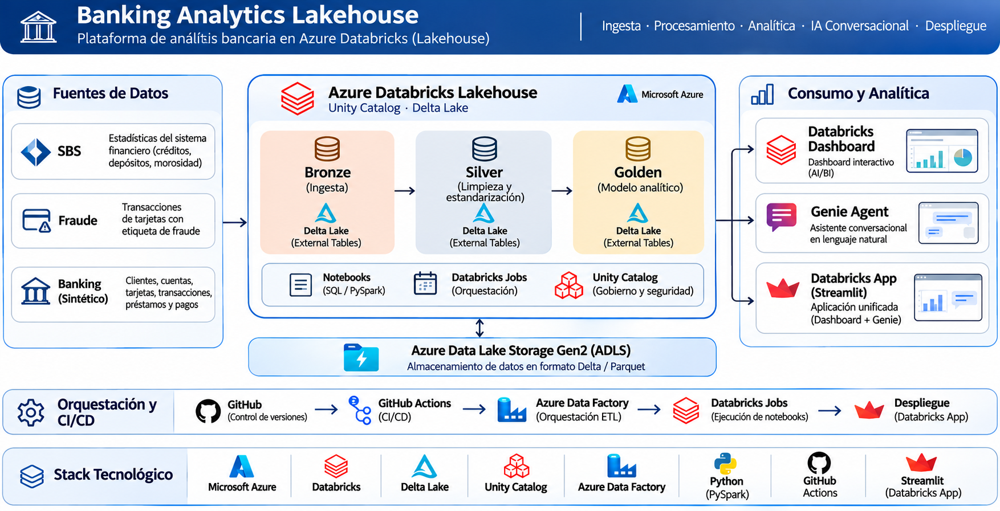
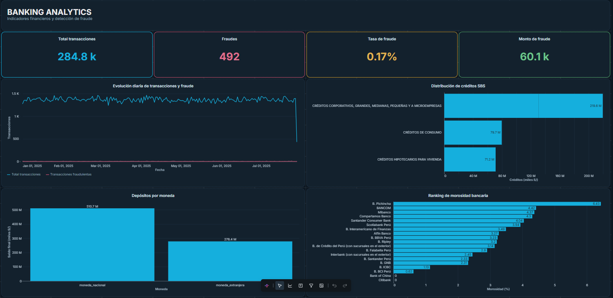
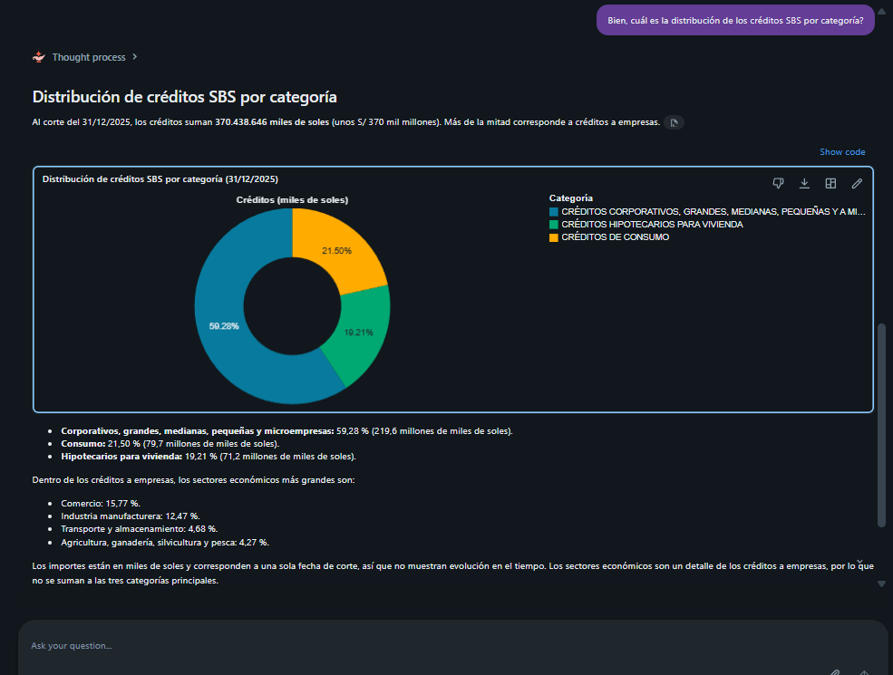
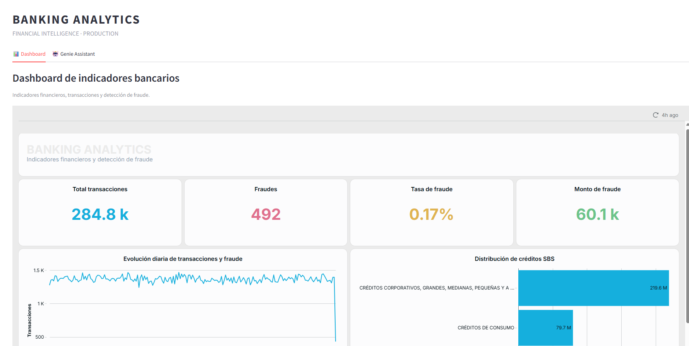
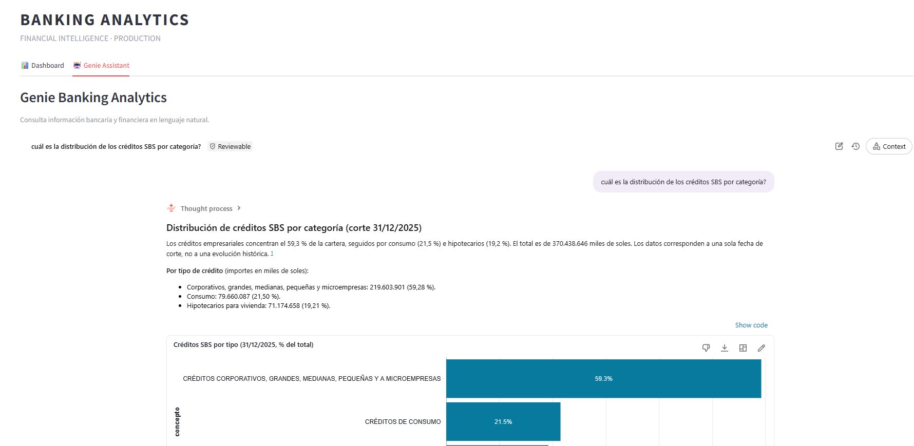

# Banking Analytics Lakehouse

La presente plataforma de datos bancaria construida sobre **Microsoft Azure y Azure Databricks**, integra información financiera de la **Superintendencia de Banca, Seguros y AFP (SBS)**, un dataset de detección de fraude y datos bancarios sintéticos. La solución implementa una arquitectura **Lakehouse Medallion**, publica indicadores en un dashboard implementado en **Databricks**, habilita consultas en lenguaje natural mediante **Genie** y reúne ambos componentes en una **Databricks App desarrollada con Streamlit**.

**Stack de tecnologías:** Microsoft Azure · Azure Data Lake Storage Gen2 · Azure Databricks · Apache Spark / PySpark · Delta Lake · Unity Catalog · Delta Sharing · Databricks Workflows · GitHub Actions · Databricks AI/BI · Genie · Streamlit

---

## Principales indicadores

**Indicadores de fraude y transacciones (Dashboard AI/BI):**
- ¿Cuántas transacciones se analizaron y cuántas fueron clasificadas como fraude?
- ¿Cuál es la tasa de fraude del dataset de detección?
- ¿Cómo evoluciona diariamente el volumen de transacciones y fraudes?
- ¿Cuál es el importe asociado a las transacciones fraudulentas?

**Indicadores financieros SBS:**
- ¿Cómo se distribuyen los créditos directos por categoría?
- ¿Cuál es el saldo de depósitos en moneda nacional y extranjera?
- ¿Qué entidades bancarias presentan los mayores índices de morosidad?
- ¿Qué conceptos financieros concentran los mayores importes?

**Analítica bancaria (Genie Agent):**
- ¿Cuántos clientes, cuentas, tarjetas y transacciones existen?
- ¿Cómo se distribuyen las transacciones por canal, tipo o estado?
- ¿Cuál es el comportamiento de préstamos y pagos registrados?
- ¿Qué entidades presentan mayor morosidad?
- ¿Cómo se distribuyen los créditos SBS por categoría?

> **Alcance de los datos:** el proyecto combina fuentes con de origen distinto. `fact_transactions` contiene operaciones bancarias sintéticas, `agg_fraud_daily` resume el dataset externo de detección de fraude, y las tablas SBS contienen información publicada para su fecha de corte. Estos conjuntos deben analizarse por separado y no interpretarse como una única cartera bancaria real.

---

## Arquitectura



La solución organiza los datos en ADLS Gen2 y utiliza Unity Catalog para administrar los metadatos, las ubicaciones externas y los permisos. Los notebooks implementan la ingesta, transformación y construcción del modelo analítico.

```text
Fuentes de datos
   │
   ├── SBS (CSV convertidos desde archivos oficiales)
   ├── Credit Card Fraud Detection (creditcard.csv)
   └── Datos bancarios sintéticos (Python / PySpark)
          │
          ▼
Azure Data Lake Storage Gen2 — Raw
          │
          ▼
Azure Databricks + Unity Catalog
          │
          ├── Bronze: ingesta y persistencia inicial (11 tablas)
          │
          ├── Silver: limpieza, estandarización y validaciones (11 tablas)
          │
          └── Golden: dimensiones, hechos y agregaciones (11 tablas)
                    │
                    ├── Databricks Dashboard
                    ├── Genie Agent
                    └── Delta Sharing ──► Power BI

Databricks App (Streamlit)
   ├── Dashboard embebido
   └── Genie Agent embebido

GitHub Actions
   └── Exportación DEV → importación PROD → creación/ejecución del job
```

**Ambientes:**

| Componente | Desarrollo | Producción |
|---|---|---|
| Workspace Databricks | `adbproject-bank12` | `adbproject-bank12prod` |
| Catálogo | `banking_dev` | `banking_prod` |
| Storage Account | `adlsprojectbank12` | `adlsprojectbank12` |
| Credencial de almacenamiento | `credential-project` | `credential-project` |

Las tablas externas de DEV y PROD mantienen ubicaciones físicas separadas. Para producción, el notebook de preparación utiliza el prefijo `banking_prod/` en las rutas físicas de las capas.

---

## Modelo de datos — Medallion

### Raw — Datos de origen

Contiene los archivos de entrada organizados por dominio:

- `raw/sbs/`: archivos CSV de créditos, depósitos y morosidad.
- `raw/fraud/creditcard.csv`: dataset de detección de fraude.
- `raw/banking/`: CSV generados para clientes, cuentas, tarjetas, transacciones, préstamos y pagos.

Los CSV de SBS convertidos utilizados por el proceso se incluyen en `datasets/sbs/convertido/`. Los archivos originales XLS se conservan en `datasets/sbs/original/`.

### Bronze — Ingesta

Se persisten los datos en tablas Delta externas, manteniendo la estructura de origen y agregando `ingestion_date`.

### Silver — Transformación

Se aplican limpieza y estandarización de datos, validación de claves y relaciones, tratamiento de valores nulos y controles previos a la escritura. Para el dataset de fraude se incorpora `transaction_date` simulada, ya que el archivo fuente no contiene una fecha de transacción de calendario.

### Golden — Modelo analítico

Se construyen 4 dimensiones, 3 tablas de hechos y 4 tablas de agregación, todas como tablas Delta externas:

- **Dimensiones:** `dim_customer`, `dim_account`, `dim_card`, `dim_date`.
- **Hechos:** `fact_transactions`, `fact_loans`, `fact_payments`.
- **Agregaciones:** `agg_fraud_daily`, `agg_sbs_creditos`, `agg_sbs_depositos`, `agg_sbs_morosidad`.

El detalle de tablas, columnas, granularidad y consideraciones de interpretación está en el [Catálogo de datos](./documentacion/02_catalogo_datos.md).

---

## Dashboard — Banking Analytics

Dashboard de Databricks AI/BI construido exclusivamente sobre tablas del esquema `banking_prod.golden`.



### Indicadores principales

| KPI | Resultado observado |
|---|---:|
| Total de transacciones del dataset de fraude | 284,807 |
| Transacciones fraudulentas | 492 |
| Tasa de fraude | 0.17 % |
| Importe de fraude | 60,127.97 EUR |

El dashboard presenta:
- Evolución diaria de transacciones y fraude.
- Distribución de créditos SBS por categoría.
- Depósitos por moneda.
- Ranking de morosidad bancaria.

**Nota:** el importe `fraud_amount` corresponde al campo `Amount` del dataset de fraude y está expresado en euros. Las cifras de créditos y depósitos SBS se almacenan en miles de soles. La información SBS incluida corresponde al corte de diciembre de 2025, no debe interpretarse como una serie histórica.

Más información: [Dashboard Databricks](./documentacion/03_dashboard.md).

---

## Genie Agent 

El agente `Genie Banking Analytics` permite consultar en lenguaje natural las tablas del esquema `banking_prod.golden`. Su configuración incorpora instrucciones para utilizar exclusivamente las fuentes Golden, no inventar resultados y distinguir los importes y fechas de cada dominio.



Ejemplos de preguntas:
- *¿Cuáles son las 5 entidades bancarias con mayor índice de morosidad?*
- *¿Cuál es la distribución de los créditos SBS por categoría?*
- *¿Cuántas transacciones existen y cuántas fueron identificadas como fraude?*

Más información: [Genie Agent & Databricks App](./documentacion/04_genie_y_app.md).

---

## Databricks App

La aplicación `banking-analytics-app` fue desarrollada con **Streamlit** y desplegada en Databricks Apps. Integra el dashboard y el Genie Agent en una interfaz con dos pestañas:

1. **Dashboard:** visualización del dashboard AI/BI publicado.
2. **Genie Assistant:** interfaz conversacional del agente Genie.




La inserción de los recursos utiliza los enlaces de embed generados por Databricks. El acceso requiere autenticación y permisos del usuario sobre la aplicación y los recursos compartidos.

---

## Volumen

| Métrica | Volumen / valor |
|---|---:|
| Tablas Bronze | 11 |
| Tablas Silver | 11 |
| Tablas Golden | 11 |
| Dimensiones Golden | 4 |
| Hechos Golden | 3 |
| Agregaciones Golden | 4 |
| Registros del dataset de fraude | 284,807 |
| Fraudes identificados en el dataset | 492 |
| Clientes sintéticos generados | 3,000 |
| Cuentas sintéticas generadas | 4,500 |
| Tarjetas sintéticas generadas | 3,000 |
| Transacciones bancarias sintéticas | 150,000 |
| Préstamos sintéticos | 1,500 |
| Pagos sintéticos | 15,000 |

Los volúmenes bancarios corresponden a los parámetros definidos en `4.Generacion_Banking.ipynb`. El total configurado de registros sintéticos es 177,000. Los conteos pueden variar si se modifican dichos parámetros.

---

## Estructura

```text
BankingAnalyticsLakehouse/
│
├── .github/
│   └── workflows/
│       └── deploy-banking.yml       ← Despliegue de notebooks y Job DEV → PROD
│
├── prepAmb/
│   └── 1.Preparacion_Ambiente_Banking.ipynb
│
├── proceso/
│   ├── 1.Preparacion_Ambiente_Banking.ipynb
│   ├── 2.Ingest_SBS.ipynb
│   ├── 3.Ingest_Fraud.ipynb
│   ├── 4.Generacion_Banking.ipynb
│   ├── 5.Ingest_Banking.ipynb
│   ├── 6.Transform_Silver.ipynb
│   ├── 7.Load_Golden.ipynb
│   └── 8.Grants_Banking.ipynb
│
├── seguridad/
│   └── 8.Grants_Banking.ipynb       ← Administración de permisos UC
│
├── delta-sharing/
│   └── Delta-SharingBanking.ipynb   ← Share de tablas Golden para Power BI
│
├── dashboard/
│   └── Dashboard_Banking_Analytics.lvdash.json
│
├── genie-agent/
│   ├── Enlace.txt
│   └── evidencias del agente
│
├── databricks-app/
│   └── banking-analytics-app/
│       ├── app.py
│       ├── app.yaml
│       └── requirements.txt
│
├── datasets/
│   └── sbs/
│       ├── original/
│       └── convertido/
|   └── fraud_transactions/
│       └── creditcard.csv (Se adjunta enlace de descarga)
│
├── evidencias/
│   ├── 1.azure/
│   ├── 2.databricks/
│   ├── 3.ETL/
│   ├── 4.CI-CD/
│   ├── 5.dashboard/
│   ├── 6.genie-agent/
│   ├── 7.databricks-app/
│   └── 8.delta-sharing/
│
├── reversion/
│   └── EliminarProduccion.ipynb
│
├── certificaciones/
└── documentacion/
    ├── 01_arquitectura_tecnica.md
    ├── 02_catalogo_datos.md
    ├── 03_dashboard.md
    ├── 04_genie_y_app.md
    ├── 05_ci_cd_y_despliegue.md
    └── 06_seguridad_y_delta_sharing.md
```

---

## Documentación

| Documento | Contenido |
|---|---|
| [01. Arquitectura técnica](./documentacion/01_arquitectura_tecnica.md) | Arquitectura Azure, ambientes DEV/PROD, ADLS, Unity Catalog y capas Medallion. |
| [02. Catálogo de datos](./documentacion/02_catalogo_datos.md) | Inventario de tablas Bronze, Silver y Golden, granularidad y consideraciones de negocio. |
| [03. Dashboard AI/BI](./documentacion/03_dashboard.md) | KPIs, datasets SQL, visualizaciones y criterios de interpretación. |
| [04. Genie Agent y Databricks App](./documentacion/04_genie_y_app.md) | Instrucciones del agente, ejemplos de consultas, estructura Streamlit e integración por iframe. |
| [05. CI/CD y despliegue](./documentacion/05_ci_cd_y_despliegue.md) | GitHub Actions, exportación/importación de notebooks, Job de producción y ejecución. |
| [06. Seguridad y Delta Sharing](./documentacion/06_seguridad_y_delta_sharing.md) | Unity Catalog grants, perfiles de acceso, Share/Recipient y consumo desde Power BI. |

---

## Consideraciones y limitaciones

- Los datos de clientes, cuentas, tarjetas, transacciones, préstamos y pagos son sintéticos, no representan operaciones de una entidad financiera real.
- El dataset de fraude es independiente de las transacciones bancarias sintéticas. No deben sumarse sus volúmenes ni combinarse sus importes como si fueran una misma fuente.
- El dataset de fraude no incluye una fecha de calendario original, `transaction_date` se genera durante la transformación Silver para habilitar análisis diario.
- Los datos SBS incluidos corresponden al corte diciembre de 2025. Una sola fecha de corte no permite inferir tendencias históricas.
- Los importes de `agg_fraud_daily` están expresados en euros. Los importes de créditos y depósitos SBS están expresados en miles de soles.
- Los notebooks utilizan estrategia FULL para los procesos descritos. Antes de volver a ejecutar cargas de producción, revisar el impacto de sobrescritura en las tablas externas.
- El workflow de GitHub Actions despliega notebooks y ejecuta el Job. La aplicación se despliega desde Databricks Apps y sus archivos se mantienen en `databricks-app/`.
- No se incluyen en el repositorio credenciales, tokens de acceso ni archivos de datos sensibles. El archivo fuente `creditcard.csv` debe estar disponible en la ruta Raw indicada por el notebook de ingesta.

