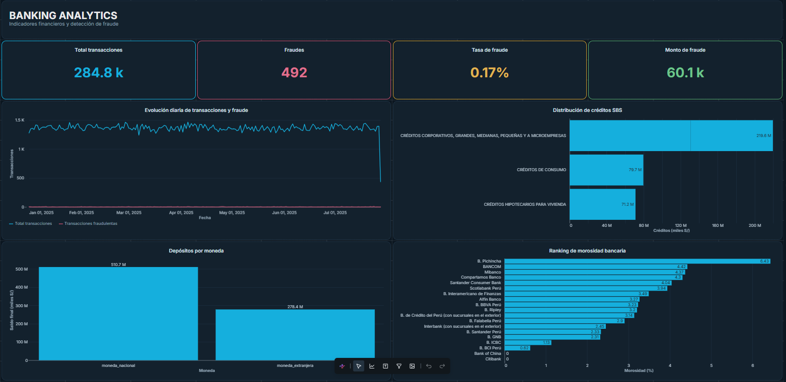
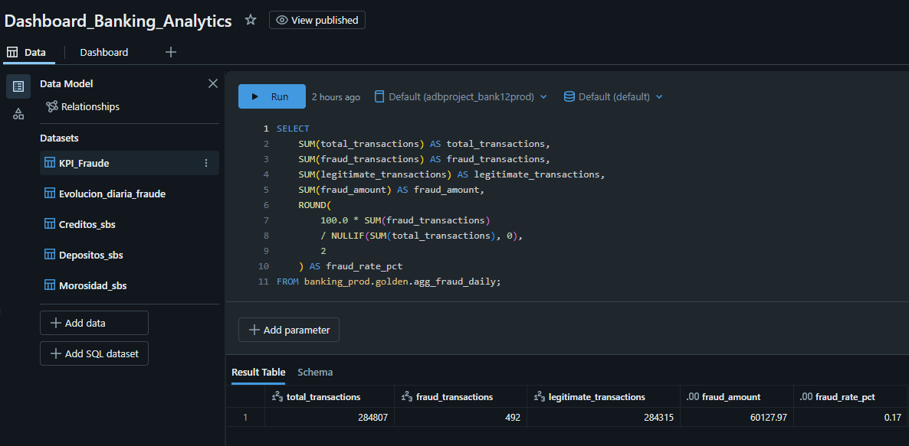
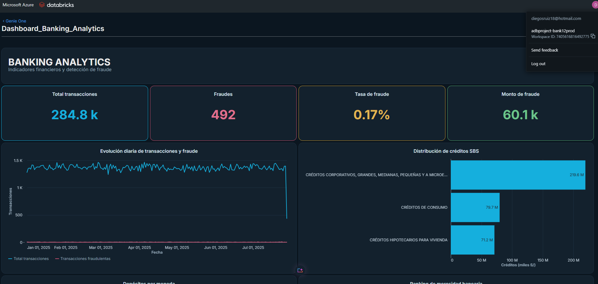

# 03. Dashboard

## Descripción

El dashboard `Dashboard_Banking_Analytics` se implementa en Databricks AI/BI y consulta exclusivamente tablas del catálogo `banking_prod`, esquema `golden`.

## Indicadores KPI

| KPI | Fuente | Resultado observado |
|---|---|---:|
| Total transacciones | `agg_fraud_daily` | 284,807 |
| Fraudes | `agg_fraud_daily` | 492 |
| Tasa de fraude | `agg_fraud_daily` | 0.17 % |
| Monto de fraude | `agg_fraud_daily` | 60,127.97 EUR |

El total y la tasa corresponden al dataset Credit Card Fraud Detection, no a la tabla de transacciones sintéticas `fact_transactions`.

## Visualizaciones

| Visualización | Fuente Golden | Objetivo |
|---|---|---|
| Evolución diaria de transacciones y fraude | `agg_fraud_daily` | Comparar volumen diario total y transacciones fraudulentas. |
| Distribución de créditos SBS | `agg_sbs_creditos` | Comparar créditos por concepto y nivel jerárquico. |
| Depósitos por moneda | `agg_sbs_depositos` | Comparar saldos finales agregados por moneda. |
| Ranking de morosidad bancaria | `agg_sbs_morosidad` | Ordenar entidades por morosidad para Total Créditos Directos. |

## Consideraciones

- La tasa global se calcula como `SUM(fraud_transactions) / SUM(total_transactions)`, no como promedio simple de tasas diarias.
- `fraud_amount` corresponde a importes EUR del dataset de fraude.
- Créditos y depósitos SBS se expresan en miles de soles.
- SBS contiene una fecha de corte (diciembre de 2025) en los datasets versionados.
- El dashboard está publicado y se comparte con permisos de visualización. La inserción en Databricks App depende de la política de dominios permitidos del workspace y de la autenticación del usuario.

## Evidencias

