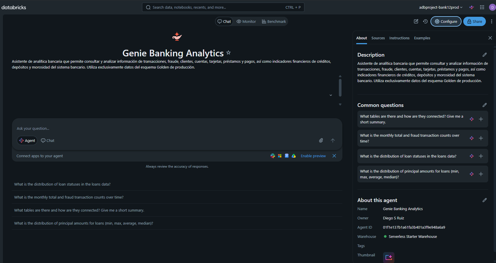
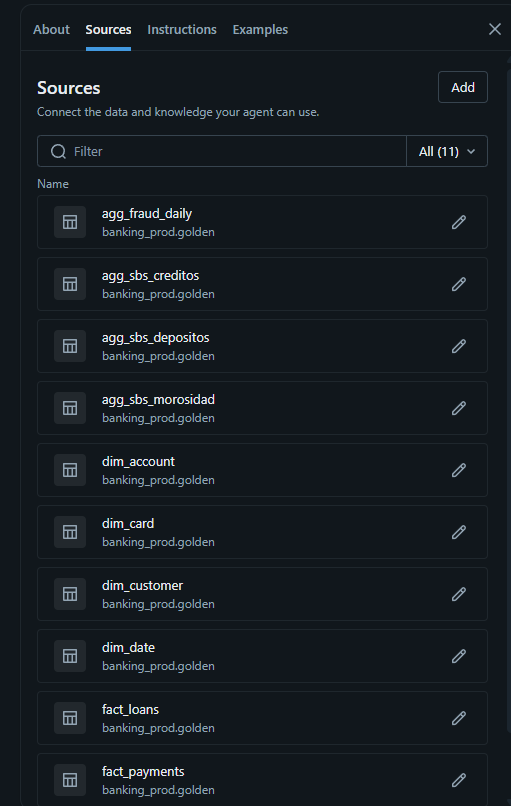
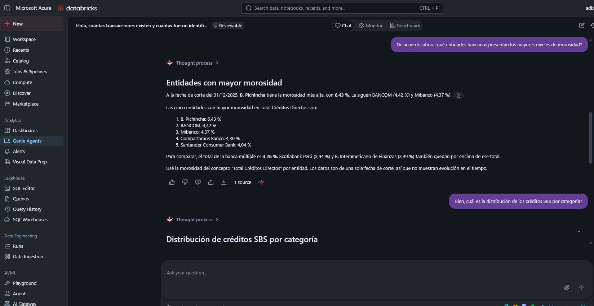
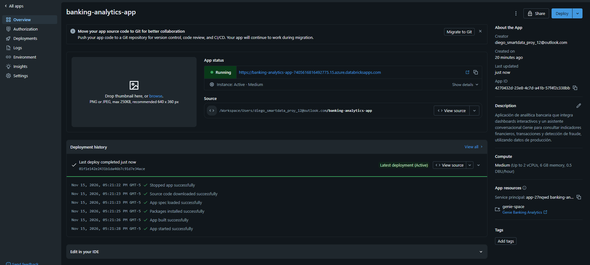
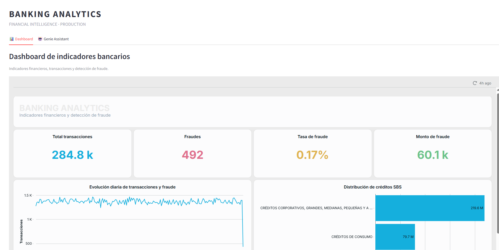
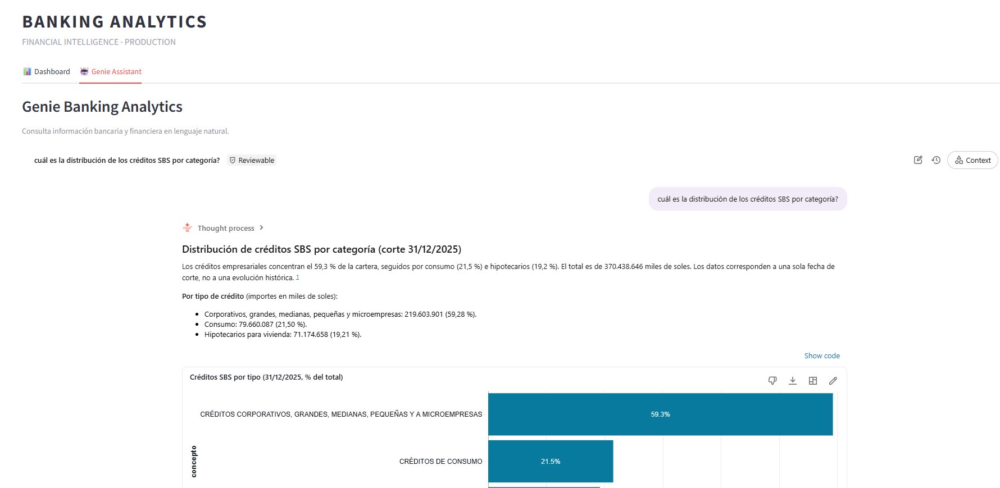

# 04. Genie Agent & Databricks App

## Genie Banking Analytics

El agente `Genie Banking Analytics` permite consultar en lenguaje natural la información disponible en el esquema `banking_prod.golden`.

### Fuentes habilitadas

El espacio Genie utiliza las 11 tablas Golden:

- `agg_fraud_daily`
- `agg_sbs_creditos`
- `agg_sbs_depositos`
- `agg_sbs_morosidad`
- `dim_account`
- `dim_card`
- `dim_customer`
- `dim_date`
- `fact_loans`
- `fact_payments`
- `fact_transactions`

### Instrucciones funcionales

El agente se configura para:
1. Utilizar exclusivamente `banking_prod.golden`.
2. No inventar resultados y reconocer cuando los datos no permiten responder.
3. Responder preferentemente en español.
4. Diferenciar el dataset de fraude de las transacciones bancarias sintéticas.
5. Interpretar `fraud_amount` en EUR.
6. Interpretar créditos y depósitos SBS en miles de soles.
7. Tratar los registros SBS como datos de su fecha de corte, no como una serie histórica.

### Ejemplos de preguntas

- ¿Cuáles son las cinco entidades bancarias con mayor índice de morosidad?
- ¿Cuál es la distribución de los créditos SBS por categoría?
- ¿Cuántas transacciones existen y cuántas fueron identificadas como fraude?
- ¿Cómo se distribuyen los depósitos por moneda?
- ¿Cuántos clientes y cuentas están registrados?







## Databricks App

La aplicación `banking-analytics-app` se desarrolla con Streamlit y se despliega en Databricks Apps. Integra dos recursos mediante:

- Dashboard publicado
- Genie Agent

### Estructura de la aplicación

```text
banking-analytics-app/
├── app.py
├── app.yaml
└── requirements.txt
```

- `app.py`: interfaz, encabezado, pestañas y componentes iframe.
- `app.yaml`: comando de inicio de Streamlit.
- `requirements.txt`: dependencias Python.

### Autenticación y permisos

La aplicación no convierte los recursos en públicos. Los usuarios deben autenticarse en Databricks y disponer de los permisos correspondientes sobre la App, el Dashboard, Genie y las tablas que Genie consulta. La inserción puede requerir permitir cookies de terceros en el navegador.






