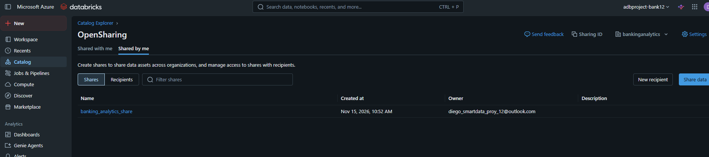
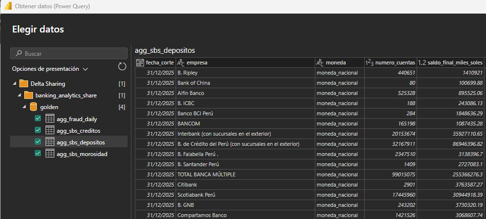
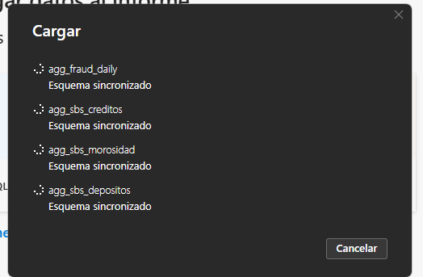
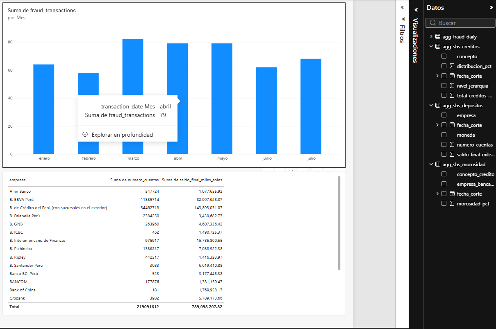

# 06. Seguridad y Delta Sharing

## Unity Catalog

Unity Catalog administra el catálogo, esquemas, tablas externas, ubicaciones y privilegios de acceso.

Catálogos del proyecto:
- `banking_dev`
- `banking_prod`

Esquemas:
- `raw`
- `bronze`
- `silver`
- `golden`

### External Locations

El notebook de preparación crea ubicaciones externas para los contenedores:
- `exlt-banking-metastore`
- `exlt-banking-raw`
- `exlt-banking-bronze`
- `exlt-banking-silver`
- `exlt-banking-golden`

La credencial de almacenamiento configurada en el proyecto es `credential-project`.

## Perfiles de acceso

El notebook `8.Grants_Banking.ipynb` define los siguientes perfiles:

| Principal / grupo | Alcance funcional |
|---|---|
| `DataEngineers` | Uso del catálogo, creación de esquemas, lectura/modificación a nivel de catálogo y creación de tablas en esquemas. |
| `DataAnalysts` | Uso del catálogo y lectura de las tablas Golden. |
| Usuarios definidos | Permisos de ingeniería según los GRANT del notebook. |

El notebook aplica permisos en los esquemas `raw`, `bronze`, `silver` y `golden`. 

Para consumo de dashboards, el usuario necesita acceso al workspace y permisos de visualización sobre el dashboard. Para Genie necesita acceso al agente y `SELECT` sobre las tablas que consulta. Para Databricks Apps, el usuario debe estar autorizado para consumir la aplicación y completar la autorización solicitada.

## Delta Sharing

El notebook `delta-sharing/Delta-SharingBanking.ipynb` configura un share de producción para exponer las tablas agregadas Golden a Power BI.

Parámetros definidos:
- Catálogo: `banking_prod`
- Esquema: `golden`
- Share: `banking_analytics_share`
- Recipient: `powerbi_banking_prod`

### Tablas compartidas

- `banking_prod.golden.agg_fraud_daily`
- `banking_prod.golden.agg_sbs_creditos`
- `banking_prod.golden.agg_sbs_depositos`
- `banking_prod.golden.agg_sbs_morosidad`

El notebook crea el Share, agrega las cuatro tablas, crea el Recipient y concede `SELECT` sobre el Share al Recipient.

### Conexión desde Power BI

El flujo de consumo utiliza Delta Sharing Databricks-to-Open mediante Bearer Token. El enlace de activación y las credenciales se obtienen desde el Recipient en Databricks.

## Seguridad operativa

- Se mantienen los tokens de Databricks en GitHub Secrets.
- No se versionan tokens de Delta Sharing ni archivos de activación con credenciales.
- Se separan los permisos de ingeniería, análisis y consumo.
